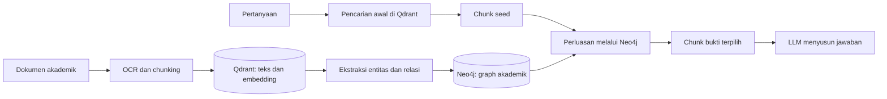
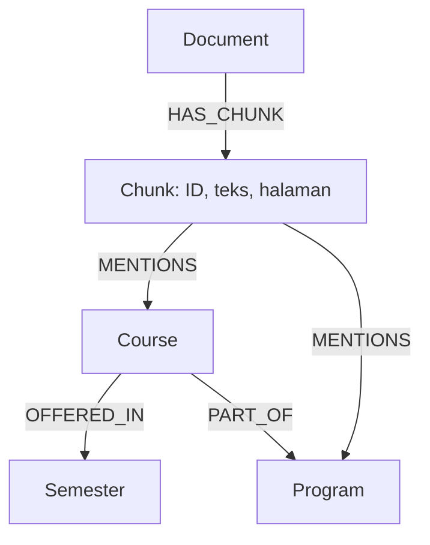
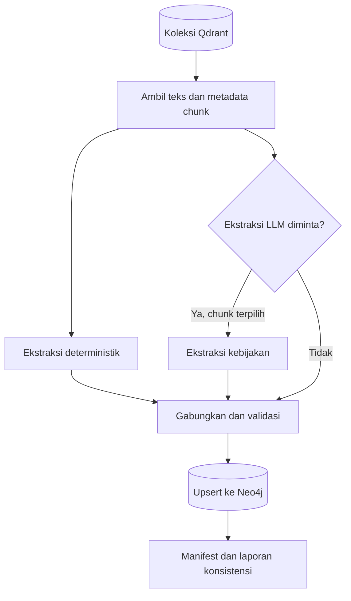
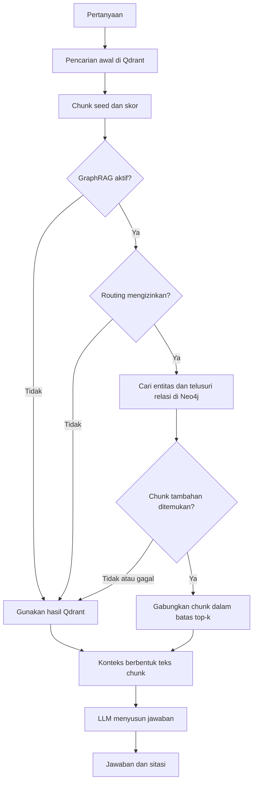

# Cara Kerja Knowledge Graph PASsistant

Dokumen ini menjelaskan implementasi knowledge graph akademik PASsistant: cara graph dibangun dari chunk Qdrant, cara dipakai saat retrieval, dan batasan yang perlu diperhatikan.

## Ringkasan

GraphRAG PASsistant menggabungkan dua penyimpanan dengan tanggung jawab berbeda:

- **Qdrant** adalah sumber utama pencarian semantik/teks dan menyimpan teks chunk yang dipakai sebagai bukti jawaban.
- **Neo4j** menyimpan representasi terstruktur berupa chunk, entitas akademik, dan relasi antar-entitas. Neo4j membantu menemukan chunk tambahan melalui hubungan tersebut.

Alur ringkasnya:



Graph tidak mengirimkan edge sebagai fakta mandiri ke model. Ia menelusuri hubungan untuk menemukan **chunk sumber** tambahan; teks chunk itulah yang masuk ke konteks jawaban.

## Diagram ringkas

### 1. Bentuk data di Neo4j



`chunk_id` pada node `Chunk` sama dengan ID chunk di Qdrant. Relasi `MENTIONS` menyimpan bukti dari chunk; relasi antar-entitas menyimpan tipe relasi, kutipan bukti, dan sumber chunk.

### 2. Proses membangun graph



Ekstraksi LLM hanya berjalan pada chunk yang dipilih berdasarkan sinyal kebijakan dan batas sampling. Ekstraksi deterministik tetap dijalankan untuk semua chunk yang dibaca.

### 3. Alur pertanyaan saat GraphRAG aktif



Dengan `GRAPH_RAG_ROUTING=multi_hop`, pertanyaan yang tidak cocok dengan marker routing langsung memakai hasil Qdrant. Jika Neo4j tidak tersedia atau tidak ada bukti tambahan, jalur fallback juga kembali ke hasil Qdrant.

## Lokasi implementasi

| File | Tanggung jawab |
|---|---|
| `src/graph/extraction.py` | Ekstraksi deterministik dan berbantuan LLM, validasi, normalisasi, serta cache ekstraksi |
| `src/graph/store.py` | Akses Neo4j, schema, upsert, traversal, pengambilan chunk, dan laporan konsistensi |
| `src/graph/expand.py` | Ekspansi query-time dari hasil awal Qdrant |
| `src/graph/indexing.py` | Sinkronisasi graph untuk ingest, penggantian, dan penghapusan dokumen |
| `scripts/build_kb_graph.py` | Membangun graph dari chunk dalam koleksi Qdrant |
| `scripts/check_graph_consistency.py` | Membandingkan ID chunk di Qdrant dan Neo4j |
| `src/config/settings.py` | Pengaturan Neo4j dan batas GraphRAG |
| `src/utils/nodes/retrieval.py` | Memanggil graph expander setelah retrieval Qdrant |

## Model data graph

### Node

- `(:Document)` menyimpan identitas dokumen, nama file, dan judul.
- `(:Chunk)` menyimpan `chunk_id`, `document_id`, teks, halaman, indeks chunk, nama file, dan hash teks.
- `(:Entity)` menyimpan `entity_id`, nama, tipe, nama ternormalisasi, dan alias.

Setiap chunk terhubung ke dokumen melalui `(:Document)-[:HAS_CHUNK]->(:Chunk)`. Hubungan chunk ke entitas dinyatakan sebagai `(:Chunk)-[:MENTIONS]->(:Entity)`, dengan `confidence` dan `evidence` pada relasi tersebut.

ID `chunk_id` di Qdrant dan Neo4j adalah join key yang sama. Ini memungkinkan Neo4j menemukan teks sumber dari chunk yang juga dikenal retrieval Qdrant.

### Tipe entitas

Implementasi mengenali tipe seperti:

- `Course`, `Program`, `Semester`, dan `ElectiveGroup`
- `Regulation`, `Requirement`, dan `Deadline`
- `Evaluation`, `Scholarship`, `Organization`, dan `Role`

Identitas entitas mencakup tipe. Jadi, entitas dengan nama sama tetapi tipe berbeda tidak otomatis digabung menjadi satu.

### Relasi

Relasi antar-entitas dibatasi oleh allow-list di `src/graph/store.py`:

`OFFERED_IN`, `PART_OF`, `REQUIRES`, `HAS_DEADLINE`, `APPLIES_TO`, `EVALUATED_BY`, `PREREQUISITE_OF`, `REQUIRED_FOR`, `CONDITION_OF`, dan `GOVERNS`.

Setiap assertion relasi menyimpan `source_chunk_id`, kutipan `evidence`, dan `confidence`. Dengan begitu, relasi dapat ditelusuri kembali ke chunk sumber yang mendukungnya.

## Bagaimana graph dibangun

### 1. Ambil chunk dari Qdrant

`build_kb_graph.py` melakukan scroll terhadap koleksi Qdrant dan mengambil payload chunk seperti ID, teks, metadata dokumen, nomor halaman, dan indeks chunk. Chunk tanpa `chunk_id` atau teks tidak diproses.

### 2. Ekstraksi deterministik

`extract_deterministic()` mengidentifikasi pola yang bisa diproses tanpa inferensi LLM, antara lain:

- kode mata kuliah `IF21Wxxxx` / `IF21Pxxxx` dan nama mata kuliah dari baris tabel;
- semester dari kode mata kuliah atau teks eksplisit;
- program studi yang tercantum dalam daftar yang dikenal;
- kelompok mata kuliah pilihan;
- relasi yang didukung pola tersebut, misalnya mata kuliah `OFFERED_IN` semester atau `PART_OF` program.

Ekstraksi ini idempotent dan tidak membutuhkan panggilan LLM.

### 3. Ekstraksi kebijakan opsional dengan LLM

Jika opsi `--llm-extract` dipakai, skrip memilih chunk yang memiliki kata sinyal kebijakan, seperti syarat, wajib, batas waktu, cuti, beasiswa, evaluasi, atau prosedur. Pemilihannya dilakukan bergiliran per dokumen sampai batas `--max-llm-chunks` tercapai.

LLM dapat menambahkan entitas kebijakan dan relasi yang dinyatakan eksplisit di chunk. Hasilnya divalidasi sebelum disimpan:

- tipe entitas dan tipe relasi harus dikenal;
- entitas generik ditolak;
- relasi harus memiliki kutipan bukti yang benar-benar muncul pada teks chunk;
- relasi yang tidak memiliki entitas sumber/target yang valid dibuang.

Hasil ekstraksi LLM dicache per hash teks dan versi prompt di `data/processed/graph_extraction/<collection>/`. Cache membantu menghindari pemanggilan ulang untuk teks dan prompt yang sama.

### 4. Simpan atau perbarui data di Neo4j

`GraphStore.upsert_chunk()` mengganti node chunk beserta ekstraksinya, lalu menghubungkannya ke node entitas dan relasi. Constraint unik pada ID chunk, entitas, dan dokumen membantu menjaga identitas stabil. Penggantian satu chunk bersifat idempotent.

Setelah proses build, skrip menghasilkan manifest di `data/processed/graph_manifests/<collection>.json`. Manifest merangkum jumlah chunk, statistik entitas/relasi, penggunaan/cache ekstraksi, waktu proses, dan hasil pemeriksaan konsistensi.

## Membangun graph

Jalankan Neo4j, lalu pastikan URL, user, password, database Neo4j dan konfigurasi Qdrant tersedia melalui environment atau `.env`.

Contoh menjalankan Neo4j lokal melalui Docker:

```bash
docker run -d --name neo4j -p 7474:7474 -p 7687:7687 \
  -e NEO4J_AUTH=neo4j/<password> neo4j:5-community
```

Build graph deterministik:

```bash
uv run python scripts/build_kb_graph.py --collection passistant_eval_v1 --reset
```

Build graph dengan ekstraksi kebijakan LLM untuk paling banyak 150 chunk terpilih:

```bash
uv run python scripts/build_kb_graph.py \
  --collection passistant_eval_v1 \
  --reset --llm-extract --max-llm-chunks 150
```

`--reset` menghapus semua node di database graph yang dikonfigurasi sebelum membangun ulang. Pastikan database tersebut memang khusus untuk graph PASsistant sebelum menggunakannya.

**Catatan implementasi:** skrip build saat ini memeriksa `OPENAI_API_KEY` saat mulai, termasuk ketika `--llm-extract` tidak digunakan. Jadi, mode deterministik tetap memerlukan nilai konfigurasi tersebut agar bisa melewati validasi awal skrip.

Untuk cek kesesuaian chunk ID setelah build:

```bash
uv run python scripts/check_graph_consistency.py --collection passistant_eval_v1
```

Perintah ini membandingkan ID chunk di Qdrant dan Neo4j. Skrip keluar dengan status gagal bila ada chunk hilang dari graph atau chunk graph yang tidak ada di Qdrant.

## Cara graph dipakai saat menjawab pertanyaan

Ekspansi graph terjadi **setelah** retrieval awal Qdrant di `RetrievalNode`:

1. Retrieval Qdrant menghasilkan daftar seed chunk beserta skor dan ID-nya.
2. Graph expander mengambil entitas yang disebut oleh seed chunk. Ia juga mencoba mencocokkan nama entitas yang muncul secara eksplisit di query.
3. Entitas yang terlalu umum—diukur dari jumlah chunk yang menyebutnya—dilewati agar traversal tidak melebar ke konsep generik.
4. Jika ada entitas dari query dengan tipe tertentu, seperti `Regulation`, `Deadline`, `Course`, `Scholarship`, atau `Evaluation`, entitas tersebut diprioritaskan bersama sejumlah kecil entitas seed.
5. Neo4j menelusuri relasi yang diizinkan sampai jumlah hop yang dikonfigurasi, dalam arah relasi mana pun.
6. Graph mencari chunk sumber lain yang menyebut entitas hasil ekspansi. Chunk seed awal dikecualikan dari kandidat tambahan.
7. Kandidat tambahan diurutkan berdasarkan banyaknya entitas yang sama, lalu digabung dengan seed untuk diteruskan sebagai konteks.

Ekspansi dibatasi oleh `top_k`: setidaknya satu seed langsung dipertahankan, dan chunk graph menggunakan sebagian slot hasil. Nilai skor chunk graph disetel menjadi setengah skor seed langsung terendah yang dipertahankan. Chunk graph ditandai `origin="graph"`, serta membawa nama entitas bersama untuk observabilitas.

Jika Neo4j tidak tersedia, ekspansi gagal, routing memutuskan untuk melewati graph, atau tidak ada chunk tambahan yang dapat dipercaya, retrieval kembali memakai hasil Qdrant saja.

## Mengaktifkan dan mengatur GraphRAG

GraphRAG **nonaktif secara default**. Atur konfigurasi Neo4j dan GraphRAG di `.env` atau environment proses:

```dotenv
NEO4J_URI=bolt://localhost:7687
NEO4J_USER=neo4j
NEO4J_PASSWORD=<password>
NEO4J_DATABASE=neo4j

GRAPH_RAG_ENABLED=true
GRAPH_RAG_ROUTING=multi_hop
GRAPH_RAG_MAX_HOPS=1
GRAPH_RAG_MAX_ENTITIES=25
GRAPH_RAG_MAX_EXTRA_CHUNKS=4
GRAPH_RAG_MAX_ENTITY_FREQUENCY=40
GRAPH_RAG_TIMEOUT_SECONDS=3.0
```

Makna opsi penting:

| Pengaturan | Dampak |
|---|---|
| `GRAPH_RAG_ENABLED` | Mengaktifkan pembuatan expander dan integrasi graph saat retrieval |
| `GRAPH_RAG_ROUTING=always` | Mencoba ekspansi graph untuk setiap query |
| `GRAPH_RAG_ROUTING=multi_hop` | Hanya mencoba ekspansi bila query memuat penanda hubungan seperti “dan”, “perbedaan”, “syarat”, “prosedur”, atau “bagaimana” |
| `GRAPH_RAG_MAX_HOPS` | Batas traversal relasi; nilai yang didukung 1–2 |
| `GRAPH_RAG_MAX_ENTITIES` | Batas entitas dalam pengambilan seed dan traversal |
| `GRAPH_RAG_MAX_EXTRA_CHUNKS` | Batas chunk tambahan dari graph |
| `GRAPH_RAG_MAX_ENTITY_FREQUENCY` | Melewati entitas yang muncul pada terlalu banyak chunk |
| `GRAPH_RAG_TIMEOUT_SECONDS` | Batas timeout koneksi/query graph |
| `GRAPH_RAG_ALLOWED_RELATIONSHIPS` | Relasi yang boleh ditelusuri; tipe tetap harus berada pada allow-list kode |

Untuk evaluasi langsung, set konfigurasi tersebut lalu jalankan pipeline live, misalnya:

```bash
uv run ragas-eval evaluate \
  --dataset tests/fixtures/eval/public_beta_v1_1.jsonl --mode live
```

Status dan detail graph dapat diamati melalui `graph_trace` pada state/log agent, termasuk jumlah entitas seed, entitas hasil ekspansi, chunk tambahan, durasi, dan ID chunk graph. Respons publik `POST /chat` tidak mengembalikan `graph_trace`; jawaban tetap menampilkan sitasi dari chunk yang dipakai.

## Panduan penggunaan end-to-end

Bagian ini adalah urutan praktis untuk menyiapkan dan menggunakan graph pada aplikasi lokal.

### Langkah 1 — Pastikan sumber dokumen sudah di Qdrant

Graph dibangun dari chunk yang sudah terindeks di Qdrant. Pastikan:

- Qdrant berjalan dan `QDRANT_URL` mengarah ke instance tersebut;
- `QDRANT_COLLECTION_NAME` menunjuk koleksi yang dipakai aplikasi;
- dokumen akademik sudah diunggah/diindeks di koleksi itu.

Koleksi yang diberikan ke `--collection` saat build harus koleksi yang sama dengan indeks yang digunakan aplikasi. Graph tidak melakukan OCR atau indexing PDF dari awal; tahapan tersebut dilakukan oleh pipeline ingest dokumen.

### Langkah 2 — Jalankan Neo4j dengan penyimpanan persisten

Contoh Docker satu baris:

```bash
docker run -d --name passistant-neo4j -p 7474:7474 -p 7687:7687 -v passistant_neo4j_data:/data -e NEO4J_AUTH=neo4j/<password-kuat> neo4j:5-community
```

Port `7687` dipakai aplikasi melalui Bolt; `7474` menyediakan Neo4j Browser. Volume `passistant_neo4j_data` menjaga data graph tetap ada setelah container dihentikan. Simpan password di `.env`, jangan di source code.

### Langkah 3 — Isi konfigurasi `.env`

Minimal, isi koneksi Neo4j, koneksi Qdrant, dan konfigurasi provider yang diperlukan:

```dotenv
NEO4J_URI=bolt://localhost:7687
NEO4J_USER=neo4j
NEO4J_PASSWORD=<password-yang-sama-dengan-container>
NEO4J_DATABASE=neo4j

QDRANT_URL=http://localhost:6333
# Isi QDRANT_COLLECTION_NAME sesuai koleksi aplikasi.

OPENAI_API_KEY=<api-key-provider>
GRAPH_RAG_ENABLED=true
GRAPH_RAG_ROUTING=multi_hop
```

Jangan salin contoh ini sebagai konfigurasi lengkap tanpa mengecek `.env` aplikasi: embedding, nama model, ukuran vector, dan endpoint provider harus sama dengan yang digunakan saat membangun indeks Qdrant.

### Langkah 4 — Bangun graph

Periksa nama koleksi yang benar, lalu jalankan build. Untuk build awal yang lebih aman, gunakan database Neo4j kosong atau database khusus PASsistant:

```bash
uv run python scripts/build_kb_graph.py --collection <nama-koleksi>
```

Untuk menambah ekstraksi kebijakan berbantuan LLM, tambahkan opsi sampling:

```bash
uv run python scripts/build_kb_graph.py --collection <nama-koleksi> --llm-extract --max-llm-chunks 150
```

Naikkan `--max-llm-chunks` jika perlu cakupan lebih luas; ini juga dapat menambah pemakaian API dan waktu build. Untuk mengganti graph dengan hasil build baru secara menyeluruh, tambahkan `--reset` **hanya jika database graph khusus PASsistant**, karena opsi ini menghapus seluruh graph di database Neo4j yang dikonfigurasi.

Skrip akan membuat manifest di `data/processed/graph_manifests/<nama-koleksi>.json`. Tinjau jumlah chunk, entity/relationship, statistik cache/pemakaian LLM, serta hasil consistency.

### Langkah 5 — Verifikasi sebelum menjalankan aplikasi

Jalankan pemeriksaan konsistensi dengan koleksi yang sama:

```bash
uv run python scripts/check_graph_consistency.py --collection <nama-koleksi>
```

Pastikan tidak ada ID di `missing_in_graph` atau `orphaned_in_graph`. Jika ada, cek bahwa build dan pemeriksaan menggunakan URL serta nama koleksi Qdrant yang sama, lalu bangun ulang graph yang sesuai.

### Langkah 6 — Nyalakan API dan ajukan pertanyaan

Restart API setelah mengubah `.env`, agar settings baru dibaca:

```bash
uv run uvicorn src.api:app --reload --port 8000
```

Contoh bertanya melalui endpoint chat (PowerShell/Windows gunakan `curl.exe`):

```bash
curl.exe -X POST http://localhost:8000/chat -F "message=Apa saja syarat cuti akademik dan batas waktunya?"
```

Pertanyaan yang menghubungkan beberapa konsep—misalnya mata kuliah dengan semester/program, atau regulasi dengan syarat/deadline—lebih berpeluang mendapat tambahan konteks dari graph. Untuk uji coba, bandingkan pertanyaan relasional dengan pertanyaan faktual sederhana. Graph tidak selalu aktif untuk semua pertanyaan ketika `GRAPH_RAG_ROUTING=multi_hop`.

Periksa `citations` dalam respons untuk mengetahui sumber dokumen jawaban. Untuk memastikan graph memang dipakai, lihat log aplikasi dan `graph_trace`; respons chat biasa tidak mengungkap trace tersebut. Jika `used` false, `skipped` dapat menunjukkan routing tidak memicu ekspansi; jika ada `error`, koneksi atau query Neo4j gagal dan sistem mencoba lanjut dengan hasil Qdrant.

### Langkah 7 — Uji fallback dan matikan bila perlu

Untuk menonaktifkan GraphRAG, ubah pengaturan dan restart aplikasi:

```dotenv
GRAPH_RAG_ENABLED=false
```

Dengan begitu aplikasi memakai retrieval Qdrant tanpa ekspansi graph. Ini berguna untuk membandingkan hasil, melakukan troubleshooting Neo4j, atau menjalankan aplikasi ketika graph sedang dibangun ulang.

### Troubleshooting singkat

| Gejala | Hal yang perlu diperiksa |
|---|---|
| Build gagal dengan `NEO4J_PASSWORD is required` | Isi `NEO4J_PASSWORD` dan pastikan container Neo4j berjalan. |
| Build gagal dengan `OPENAI_API_KEY is required` meskipun tanpa `--llm-extract` | Skrip saat ini tetap memvalidasi variabel itu saat startup; isi key yang sesuai. |
| Tidak ada chunk di koleksi | Periksa `QDRANT_URL`, `QDRANT_COLLECTION_NAME`, dan argumen `--collection`; pastikan ingest sudah selesai. |
| Aplikasi tetap hanya memakai Qdrant | Periksa `GRAPH_RAG_ENABLED=true`, `NEO4J_PASSWORD`, URI/database, lalu restart API. |
| `graph_trace.skipped` berisi `routing` | Query tidak cocok dengan marker `multi_hop`; uji sementara dengan `GRAPH_RAG_ROUTING=always`. |
| Trace menunjukkan nol seed entity | Chunk hasil Qdrant mungkin belum memiliki entitas yang diekstrak; tinjau hasil build atau jalankan ekstraksi LLM untuk chunk kebijakan. |
| Graph gagal tetapi chat tetap menjawab | Ini fallback yang disengaja; lihat warning log dan status koneksi Neo4j. |

## Sinkronisasi saat ingest dan penghapusan

Jika graph retrieval diaktifkan dan password Neo4j tersedia, `GraphChunkIndexer` dapat dipakai sebagai hook sinkronisasi dokumen:

- ingest atau reindex meng-upsert chunk beserta ekstraksi deterministiknya;
- penggantian dokumen menghapus node chunk lama yang tidak lagi ada;
- penghapusan dokumen menghapus node dokumen/chunk terkait dan entitas yang tidak lagi disebut chunk mana pun.

Hook sinkronisasi otomatis ini menggunakan ekstraksi deterministik. Ekstraksi kebijakan LLM yang lebih luas dijalankan melalui `scripts/build_kb_graph.py --llm-extract`; jangan menganggap setiap ingest otomatis melakukan ekstraksi kebijakan LLM.

## Konsistensi dan pemeliharaan

Neo4j adalah representasi turunan dari chunk Qdrant, bukan sumber canonical teks. Setelah perubahan pipeline indexing, koleksi, atau ekstraksi:

1. Bangun ulang graph dari koleksi Qdrant yang benar bila perlu.
2. Jalankan `scripts/check_graph_consistency.py` untuk membandingkan himpunan ID chunk.
3. Periksa manifest build dan log bila ekstraksi gagal atau graph tidak lengkap.
4. Jika graph usang atau tidak tersedia, nonaktifkan `GRAPH_RAG_ENABLED` agar aplikasi tetap memakai retrieval Qdrant.

Cache ekstraksi LLM berada di `data/processed/graph_extraction/`; manifest berada di `data/processed/graph_manifests/`. Keduanya merupakan artefak lokal hasil pemrosesan.

## Batasan yang perlu diketahui

- Ekstraksi deterministik hanya menangkap pola yang sudah ditulis dalam parser; struktur dokumen lain mungkin tidak terwakili.
- Ekstraksi kebijakan LLM bersifat opsional dan dapat dibatasi dengan `--max-llm-chunks`. Chunk yang tidak terpilih tidak otomatis memiliki cakupan kebijakan graph.
- Query matching untuk entitas menggunakan nama ternormalisasi yang ditemukan di teks query; parafrasa yang tidak menyebut nama entitas belum tentu mengaktifkan jalur yang diharapkan.
- Batas jumlah hop, entitas, frekuensi entitas, timeout, dan chunk tambahan sengaja membatasi cakupan traversal.
- Chunk graph berbagi anggaran `top_k` dengan hasil langsung, sehingga sebagian seed Qdrant dapat tergeser ketika slot tambahan dipakai.
- Dokumentasi evaluasi GraphRAG yang ada menyatakan belum ada peningkatan kualitas yang terbukti; fitur ini nonaktif secara default dan sebaiknya dievaluasi pada dataset proyek sebelum diandalkan.
- Graph ini ditujukan untuk knowledge base publik akademik. Jangan masukkan data record mahasiswa ke dalam graph.

## Dokumentasi terkait

- [`docs/graphrag.md`](../docs/graphrag.md) — desain, evaluasi, dan konfigurasi GraphRAG.
- [`docs/retrieval-pipeline.md`](../docs/retrieval-pipeline.md) — pipeline indexing dan retrieval.
- [`docs/architecture.md`](../docs/architecture.md) — arsitektur aplikasi.
- [`.agent/PROJECT_GUIDE.md`](PROJECT_GUIDE.md) — panduan umum proyek.
