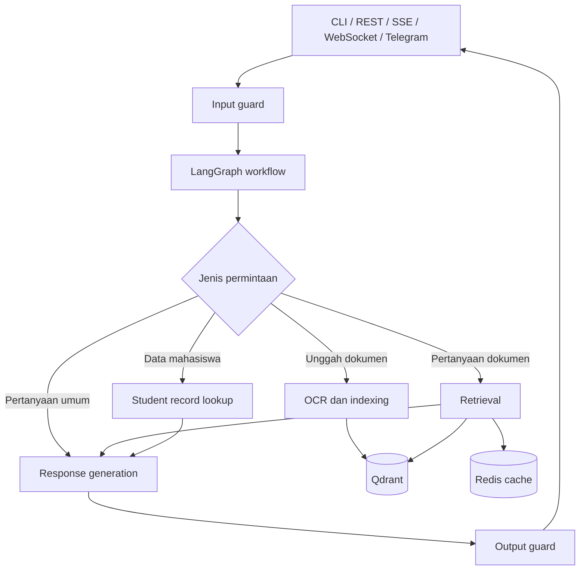

# Panduan Proyek PASsistant

Panduan ini menjelaskan tujuan, alur kerja, struktur kode, cara menjalankan, dan area pengembangan utama PASsistant. Dokumentasi teknis yang lebih spesifik tetap berada di `docs/`.

## 1. Ringkasan

PASsistant adalah chatbot layanan akademik berbasis **Python**, **LangGraph**, dan **RAG (Retrieval-Augmented Generation)** untuk menjawab pertanyaan terkait dokumen akademik dan data mahasiswa. Sistem dapat menerima dokumen PDF, mengekstrak teks melalui OCR, mengindeks isinya, mencari konteks yang relevan, lalu menyusun jawaban dengan bantuan model bahasa.

Selain chat, proyek menyediakan REST API, streaming SSE dan WebSocket, integrasi Telegram, alat evaluasi RAGAS, serta jalur GraphRAG opsional dengan Neo4j.

## 2. Teknologi utama

| Bagian | Teknologi |
|---|---|
| Bahasa dan versi minimum | Python 3.11+ |
| Manajemen paket | UV |
| Alur chatbot | LangGraph |
| HTTP API | FastAPI + Uvicorn |
| Vector store | Qdrant |
| Cache | Redis |
| Model bahasa dan embedding | Endpoint OpenAI-compatible; model dikonfigurasi melalui environment |
| OCR PDF | GLM-OCR melalui Zhipu AI |
| Evaluasi | RAGAS (opsional) |
| Pengujian dan kualitas kode | pytest, Ruff, basedpyright |

## 3. Gambaran arsitektur



Komponen utamanya:

- **Adapter antarmuka** menerima dan mengubah permintaan dari CLI, HTTP, streaming, atau Telegram.
- **LangGraph workflow** mengarahkan permintaan ke node yang sesuai dan mengelola state percakapan.
- **Service layer** berisi logika seperti pemrosesan dokumen, indexing, klasifikasi intent, dan pembuatan jawaban.
- **Clients dan utilities** menghubungkan aplikasi dengan Qdrant, Redis, model bahasa, embedding, OCR, dan reranker.
- **Guardrails** memeriksa input dan output serta menerapkan pembatasan request.

## 4. Alur utama

### Pertanyaan atas dokumen

1. Input diperiksa oleh input guard.
2. Workflow menentukan bahwa permintaan memerlukan pencarian dokumen.
3. Sistem dapat menulis ulang atau memperluas pertanyaan, lalu mencari beberapa variasi query secara paralel.
4. Kandidat diambil dari Qdrant menggunakan strategi retrieval yang dikonfigurasi. Strategi yang tersedia meliputi similarity, RRF/hybrid dense dan BM25, serta reranking.
5. Konteks yang relevan diteruskan ke model bahasa untuk menyusun jawaban.
6. Output diperiksa sebelum dikirim kembali.

### Ingest dokumen

Dokumen akademik diunggah melalui endpoint dokumen. PDF diproses halaman demi halaman dengan OCR, kemudian teks dipecah menjadi chunks, diberi metadata sumber/halaman, di-embedding, dan disimpan di Qdrant. Jika OCR cache aktif, hasil OCR disimpan agar dokumen dapat diindeks ulang tanpa menjalankan OCR kembali.

### Data mahasiswa

Workflow dapat mengarahkan permintaan yang berkaitan dengan data mahasiswa ke service/tool pencarian record. Perhatikan bahwa akses terhadap data ini perlu mengikuti kebijakan dan kontrol akses institusi; jangan memasukkan data pribadi ke fixture, log, atau dokumentasi.

## 5. Struktur repository

```text
.
├── .agent/                 # Catatan dan panduan kerja proyek
├── data/
│   ├── raw/                 # Dokumen sumber
│   └── processed/           # Data hasil pemrosesan, termasuk OCR cache
├── docs/                    # Dokumentasi API, arsitektur, deployment, evaluasi
├── experiments/             # Catatan eksperimen dan hasil
├── scripts/                 # Skrip setup, indexing, evaluasi, dan utilitas
├── src/
│   ├── agent.py             # Entry point LangGraph dan CLI interaktif
│   ├── api/                 # FastAPI, routes, skema, sessions, orchestration
│   ├── clients/             # Klien model, embedding, OCR, Qdrant, Redis, dll.
│   ├── config/              # Settings environment dan logging
│   ├── eval/                 # CLI dan pipeline evaluasi RAGAS
│   ├── graph/                # Komponen graph knowledge base/GraphRAG
│   ├── graphs/               # Definisi workflow LangGraph utama
│   ├── guardrails/           # Validasi input/output dan rate limiting
│   ├── services/             # Logika bisnis dan pemrosesan dokumen
│   ├── telegram_bot/         # Integrasi Telegram
│   └── utils/                # State, nodes, tools, cache, vector store
├── tests/                    # Unit, API, integration, smoke, system, regression
├── pyproject.toml            # Dependencies, CLI, dan konfigurasi tool
└── uv.lock                   # Versi dependency terkunci
```

Untuk penjelasan modul yang lebih terperinci, lihat [`docs/project-structure.md`](../docs/project-structure.md).

## 6. Persiapan lokal

### Prasyarat

- Python 3.11 atau lebih baru
- UV
- Docker untuk menjalankan Qdrant dan Redis secara lokal
- Kredensial provider yang sesuai untuk model bahasa dan GLM-OCR

### Instalasi

```bash
uv sync --all-extras
```

Salin `.env.example` menjadi `.env`, lalu isi konfigurasi dan kredensial yang dibutuhkan. Di PowerShell, gunakan `Copy-Item .env.example .env`; di shell Unix, gunakan `cp .env.example .env`. Lihat [`docs/deployment.md`](../docs/deployment.md) dan [`docs/api-keys.md`](../docs/api-keys.md) untuk detail provider. Jangan commit `.env` atau kredensial.

Variabel inti umumnya mencakup:

- `OPENAI_API_KEY`, `OPENAI_BASE_URL`, dan `LLM_MODEL` untuk provider LLM.
- `EMBEDDING_MODEL` dan `VECTOR_SIZE` untuk embedding.
- `ZHIPU_API_KEY` untuk OCR.
- `QDRANT_URL` dan `REDIS_URL` untuk layanan infrastruktur.
- Variabel retrieval/reranker, misalnya `RETRIEVAL_STRATEGY` dan `RETRIEVAL_TOP_K`.

Nilai dan opsi lengkap dapat berbeda sesuai mode deployment; rujuk dokumentasi deployment dan konfigurasi di `src/config/settings.py`.

### Menjalankan infrastruktur

Jalankan Qdrant dan Redis secara lokal, misalnya:

```bash
docker run -p 6333:6333 -p 6334:6334 qdrant/qdrant
docker run -p 6379:6379 redis:7-alpine
```

Alternatif untuk Qdrant tersedia melalui `scripts/run_qdrant.sh`.

## 7. Menjalankan aplikasi

### CLI interaktif

```bash
uv run chatbot
```

### REST API

```bash
uv run uvicorn src.api:app --reload --port 8000
```

Dokumentasi Swagger tersedia di `http://localhost:8000/docs` setelah server berjalan.

### Telegram polling

```bash
uv run python -m src.telegram_bot.polling
```

### Endpoint utama

| Method | Endpoint | Kegunaan |
|---|---|---|
| `GET` | `/health` | Status API dan dependency |
| `POST` | `/chat` | Mengirim pertanyaan chat |
| `POST` | `/chat/stream` | Chat streaming menggunakan SSE |
| `POST` | `/upload` | Mengunggah dan mengindeks dokumen |
| `GET` | `/documents` | Melihat dokumen yang diindeks |
| `DELETE` | `/documents/by-filename/{filename}` | Menghapus dokumen berdasarkan nama file |
| `WS` | `/ws/{thread_id}` | Streaming chat melalui WebSocket |

Endpoint admin untuk reindex memerlukan `X-Admin-Key` yang cocok dengan `ADMIN_API_KEY`. Jika kunci admin tidak dikonfigurasi, endpoint tersebut menolak request. Daftar endpoint dan bentuk payload lengkap ada di [`docs/api.md`](../docs/api.md).

## 8. Pengujian dan pemeriksaan kualitas

```bash
# Seluruh test suite
uv run pytest

# Test tertentu
uv run pytest tests/unit -v

# Format dan lint
uv run ruff format .
uv run ruff check .

# Type check
uv run basedpyright src/
```

Beberapa test system atau smoke memerlukan layanan eksternal, server yang aktif, atau kredensial. Lihat marker dan fixture di `tests/` sebelum menjalankan test yang membutuhkan dependency tersebut.

## 9. Evaluasi RAG

Paket evaluasi tersedia melalui command `ragas-eval` (termasuk dalam extras evaluasi):

```bash
uv run ragas-eval validate --dataset testset.jsonl
uv run ragas-eval build-dataset --output testset.jsonl --testset-size 20
uv run ragas-eval evaluate --dataset testset.jsonl --mode live
uv run ragas-eval sweep --dataset testset.jsonl
```

Mode fixture dapat digunakan untuk menilai jawaban yang sudah direkam tanpa menjalankan pipeline live. Hasil evaluasi mencakup metrik seperti Faithfulness, Context Recall, dan Factual Correctness. Panduan lengkap tersedia di [`docs/evaluation.md`](../docs/evaluation.md).

GraphRAG adalah jalur opsional yang menghubungkan chunk Qdrant dengan graph Neo4j. Gunakan hanya jika Neo4j sudah disiapkan dan konfigurasi GraphRAG telah diisi. Rincian ada di [`docs/graphrag.md`](../docs/graphrag.md).

## 10. Panduan perubahan kode

| Kebutuhan | Lokasi awal |
|---|---|
| Mengubah endpoint atau kontrak API | `src/api/routes/`, `src/api/models.py` |
| Mengubah alur permintaan | `src/graphs/workflow.py`, `src/utils/nodes/` |
| Mengubah retrieval, indexing, atau reranking | `src/utils/vector_store/`, `src/utils/nodes/retrieval.py`, `src/services/indexing.py` |
| Mengubah OCR dan ingest | `src/services/document_processing.py`, `src/utils/tools/` |
| Mengubah prompt | `src/utils/nodes/prompts/` |
| Mengubah integrasi Telegram | `src/telegram_bot/`, `src/api/routes/telegram.py` |
| Mengubah konfigurasi | `src/config/settings.py` |
| Mengubah evaluasi | `src/eval/` |
| Menambah test atau fixture | `tests/` |
| Mengubah dependency atau command | `pyproject.toml`, lalu perbarui `uv.lock` |

Usahakan logika fitur berada di workflow/service agar bisa dipakai oleh beberapa adapter. Adapter sebaiknya fokus menerjemahkan format input dan output masing-masing.

## 11. Data, keamanan, dan operasional

- Jangan simpan API key, token, data mahasiswa, atau dokumen sensitif di source code, fixture, atau file dokumentasi.
- Dokumen di `data/raw/` adalah input; file di `data/processed/` dapat berisi hasil ekstraksi OCR. Perlakukan keduanya sesuai klasifikasi data institusi.
- Session dan rate limiter disebut sebagai in-memory; state tersebut tidak otomatis dibagi antar proses aplikasi.
- Jangan mengekspos Qdrant/Redis ke jaringan publik tanpa kontrol akses dan konfigurasi jaringan yang sesuai.
- Gunakan `GET /health` untuk memeriksa API dan dependency; periksa log terstruktur dan tracing jika diaktifkan.
- Untuk deployment, webhook Telegram, logging, monitoring, dan rekomendasi produksi, lihat [`docs/deployment.md`](../docs/deployment.md).

## 12. Dokumentasi terkait

- [`README.md`](../README.md) — ringkasan, quick start, command, dan fitur.
- [`docs/architecture.md`](../docs/architecture.md) — arsitektur dan lifecycle request.
- [`docs/api.md`](../docs/api.md) — referensi endpoint.
- [`docs/api-keys.md`](../docs/api-keys.md) — panduan kredensial provider.
- [`docs/retrieval-pipeline.md`](../docs/retrieval-pipeline.md) — indexing dan retrieval.
- [`docs/evaluation.md`](../docs/evaluation.md) — evaluasi RAGAS.
- [`docs/graphrag.md`](../docs/graphrag.md) — jalur GraphRAG opsional.
- [`docs/deployment.md`](../docs/deployment.md) — deployment dan operasional.
- [`docs/project-structure.md`](../docs/project-structure.md) — detail struktur repository.
