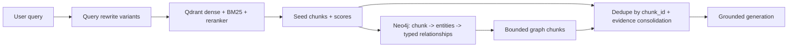

# GraphRAG: Qdrant + Neo4j

This document describes the graph-augmented retrieval path added to PASsistant.
The existing Qdrant retrieval pipeline remains the default and the fallback. The
graph is a derived representation of the same knowledge-base documents.

## Architecture



Qdrant remains the source of chunk text and direct evidence. Neo4j stores the
same chunks under the exact Qdrant `chunk_id`, plus academic entities and
relationships extracted from those chunks. Graph expansion only adds source
chunks; graph edges are never passed to the generator as standalone facts.

## Stable identity

- Qdrant payload `chunk_id` is the join key.
- Neo4j node `(:Chunk {chunk_id})` uses the same string.
- Re-indexing a document replaces its chunk nodes and prunes graph chunks that no
  longer exist in Qdrant (`GraphChunkIndexer.replace_document`).
- Deleting a document removes its graph chunks and then deletes orphan entities
  (`GraphIndexer.delete_document`).
- `GraphStore.consistency_report` compares the Qdrant chunk-id set with Neo4j and
  reports missing/orphaned chunks and mentions without provenance.

## Ontology

Entities:

| Type | Examples |
|---|---|
| Course | Keamanan Informasi (IF21W0803) |
| Program | Teknik Informatika |
| Semester | Semester VIII |
| Regulation | Cuti Akademik |
| Requirement | Biaya administrasi cuti 5% dari DPP satu tahun |
| Deadline | 1 Juli - 30 September |
| Evaluation | Evaluasi Tahap I |
| Scholarship | KIP Kuliah |
| Organization | Fakultas Teknik |
| Role | Dekan, Wakil Rektor III |

Relationships are typed and bounded to the set in `ALLOWED_RELATIONSHIP_TYPES`:

`OFFERED_IN`, `PART_OF`, `REQUIRES`, `HAS_DEADLINE`, `APPLIES_TO`,
`EVALUATED_BY`, `PREREQUISITE_OF`, `REQUIRED_FOR`, `CONDITION_OF`, `GOVERNS`.

Every `(:Chunk)-[:MENTIONS]->(:Entity)` relationship stores the extraction
confidence and a source span. Every typed entity-to-entity relationship stores
`source_chunk_id`, an exact `evidence` quote, and `confidence`. The node model is
`(:Entity {entity_id, name, entity_type, normalized_name, aliases})`; entity
identity includes the type, so a Course and a Program with the same name are not
merged.

## Extraction

Two layers:

1. **Deterministic** (`src/graph/extraction.py`): course codes (`IF21Wxxxx` /
   `IF21Pxxxx`), course titles and SKS from table rows, semester from the course
   code, and program mentions. This layer is idempotent and has no LLM cost.
2. **LLM policy extraction** (optional, cached): regulation, requirement,
   deadline, evaluation, scholarship, organization, and role entities plus typed
   relationships. The extractor treats the chunk as data, requires an exact
   evidence quote for every relationship, rejects unsupported relationship types,
   and drops relationships whose evidence is not present in the source chunk.
   Results are cached under
   `data/processed/graph_extraction/<collection>/<sha256>.json`, keyed by the
   chunk text and prompt version.

## Build

```bash
# Neo4j (Docker)
docker run -d --name neo4j -p 7474:7474 -p 7687:7687 \
  -e NEO4J_AUTH=neo4j/<password> neo4j:5-community

# deterministic graph (fast, no LLM)
uv run python scripts/build_kb_graph.py --collection passistant_eval_v1 --reset

# deterministic + policy graph (cached LLM extraction)
uv run python scripts/build_kb_graph.py --collection passistant_eval_v1 \
  --reset --llm-extract --max-llm-chunks 150
```

The script writes a manifest to
`data/processed/graph_manifests/<collection>.json` with chunk counts, entity and
relationship counts, extraction usage, and the consistency report.

## Query-time expansion

`RetrievalNode` runs Qdrant retrieval first. When `GRAPH_RAG_ENABLED=true` and a
Neo4j password is configured, `GraphExpander`:

1. Takes the seed chunk ids and finds their entities (bounded by
   `GRAPH_RAG_MAX_ENTITY_FREQUENCY` to skip generic entities).
2. Prefers entities named in the query when any are found.
3. Traverses at most `GRAPH_RAG_MAX_HOPS` typed relationships in both directions.
4. Fetches source chunks that mention the expanded entities, excluding seeds.
5. Reserves at most `GRAPH_RAG_MAX_EXTRA_CHUNKS` context slots, keeping the
   strongest direct seeds first. Graph chunks are marked `origin="graph"` and
   carry the shared entity names.
6. Returns the original seeds unchanged if Neo4j is unavailable, the query is
   routed away from graph expansion, or no reliable expansion is found.

Limits: `GRAPH_RAG_MAX_ENTITIES`, `GRAPH_RAG_MAX_EXTRA_CHUNKS`,
`GRAPH_RAG_MAX_HOPS` (1-2), `GRAPH_RAG_TIMEOUT_SECONDS`, and
`GRAPH_RAG_ALLOWED_RELATIONSHIPS`. Cypher queries are parameterized; the only
dynamically interpolated value is a relationship type validated against the
allow-list.

## Routing

- `GRAPH_RAG_ROUTING=always`: expand every query (Candidate B).
- `GRAPH_RAG_ROUTING=multi_hop`: expand only relationship-heavy queries such as
  `dan`, `serta`, `beda`, `syarat`, `prosedur`, `bagaimana` (Candidate C).
- `GRAPH_RAG_ENABLED=false`: existing RAG only (Baseline A).

## Evaluation

All candidates use the same testset (`public_beta_v1_2.jsonl` for the final run),
the same RAGAS judge, `FactualCorrectness(mode="f1")`, and the same index.

```bash
# Baseline A: vector retrieval only
GRAPH_RAG_ENABLED=false uv run python -m src.eval evaluate \
  --dataset tests/fixtures/eval/public_beta_v1_1.jsonl --mode live \
  --run-name baseline_A --output-dir src/eval/reports

# Candidate B: graph expansion, same generation settings
GRAPH_RAG_ENABLED=true GRAPH_RAG_ROUTING=always uv run python -m src.eval evaluate \
  --dataset tests/fixtures/eval/public_beta_v1_1.jsonl --mode live \
  --run-name candidate_B --output-dir src/eval/reports
```

Graph-specific diagnostics are logged in `graph_trace` on the agent state:
seed entity count, expanded entity count, extra chunk count, elapsed milliseconds,
and the graph chunk ids.

Measured offline ablation (2026-10-27, 65 baseline samples): graph expansion added
2.42 chunks on average to 53 samples, but because it reserves slots inside the fixed
top-k budget it displaced direct seeds. The lexical reference-coverage proxy moved from
0.7903 to 0.7833; no tested `max-extra`/routing setting improved it. GraphRAG is therefore
left disabled by default and is **not** claimed as a quality improvement. Full RAGAS
Candidate B/C scores are blocked pending a working judge quota; see
`experiments/FINAL_RESULTS.md`.

## Limitations

- Neo4j is a derived store; if it is stale, disable graph retrieval and rebuild
  from Qdrant with `scripts/build_kb_graph.py`.
- LLM extraction is sampled (`--max-llm-chunks`); chunks outside the sample only
  receive deterministic links. Increase the sample or rebuild before relying on
  policy graph coverage.
- The graph currently has no authorization layer beyond the public knowledge
  base; student-record data must never be indexed into it.
